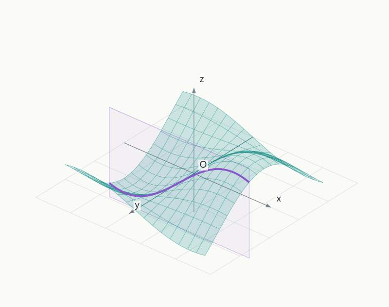

# Math Space Lab

An interactive mathematics workbench for exploring surfaces, 3D coordinates, linear transformations and cubic crystals, with MCP interfaces for compatible chat clients.

[中文说明](README.zh-CN.md) · [Development](docs/DEVELOPMENT.md) · [Validation](docs/VALIDATION.md)

## The problem

A formula in a chat is often static. Math Space Lab lets a learner change parameters, rotate a scene, inspect a cross-section and connect the picture to the explanation. It grew from practical mathematics and physics study needs.



*Canvas-only preview from the local workbench; surrounding controls are omitted.*

## Four experiments

| Scene | Explore |
| --- | --- |
| Surfaces | Quadratic surfaces, spheres, custom `z=f(x,y)`, and cross-sections |
| Coordinates | A 3D point and its coordinate projections |
| Matrices | A 3×3 transformation, basis vectors, a unit cube, determinant and numerical rank |
| Crystals | SC, BCC and FCC lattices and (100), (110), (111) planes |

## Run locally

Requires Node.js 20+ and Python 3. No model API key is needed to use the workbench.

```sh
cd math-plugin
npm ci
npm run build:bridge
cd ..
python scripts/build-ui.py
cd math-site
npm ci
npm run build
npm test
npm run dev
```

Open **http://127.0.0.1:52186/**. The `math-site` preview serves the app and a stateless MCP endpoint at `/mcp`. To use the separate Node MCP server, run `npm start` in `math-plugin`; the endpoint is `http://127.0.0.1:52184/mcp`. Rendering inside a chat additionally requires a client supporting MCP Apps; a generic MCP client may only expose the tools.

## Demo

Start with a quadratic surface, drag its parameters and cross-section, then switch to matrices and compare a shear with a plane projection. Finish with an FCC lattice and its (111) plane. All views run in the browser.

## Development checks

```sh
node math-lab-src/test-expression.cjs
node math-lab-src/test-matrix-analysis.cjs
node math-lab-src/check-matrix-crystal.cjs
cd math-plugin
npm test
```

## Source layout

- `math-lab-src/`: maintained scene modules and templates.
- `scripts/build-ui.py`: portable UI generation; no personal paths or installed Codex plugins required.
- `math-plugin/`: local Node MCP server and browser bridge source.
- `math-site/`: Worker-compatible MCP server and local preview adapter.

Generated HTML is checked in to make the UI inspectable; regenerate it after changing scene code. This publication does not redeploy any existing hosted instance.

## Limits and privacy

This is a teaching visualization, not a symbolic algebra system or a general physics engine. Expression syntax, sampling domains and input bounds are limited. Matrix rank uses a relative numerical tolerance and should not be interpreted as an exact symbolic proof.

The app does not contain an LLM or save chat history on a backend. A chat host may process tool inputs. The local preview binds to loopback. If you deploy the Worker publicly, configure access control and rate limits yourself: this repository does not include the original account's hosting authentication.

## License and credits

MIT for the project source. MCP libraries, Express, Zod, esbuild and other dependencies retain their own licenses; see [third-party notes](THIRD_PARTY_NOTICES.md). Development used AI coding assistants and this is an existing portfolio project.
